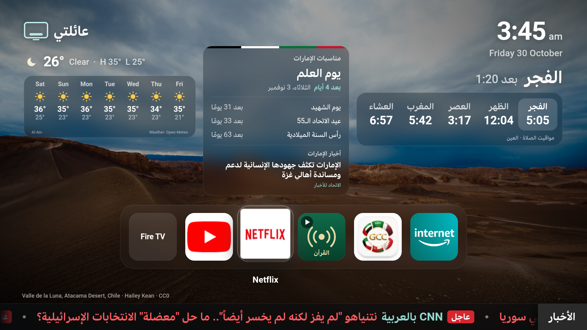
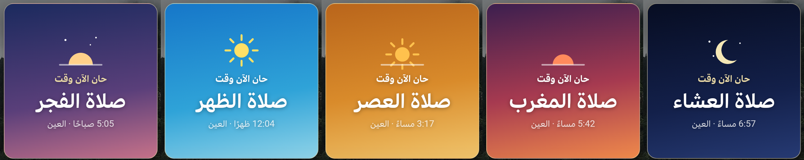

# عائلتي — شاشة رئيسية لـ Fire TV

شاشة رئيسية عربية لعصا Amazon Fire TV، مبنية على واجهة
[Glass Home](https://github.com/victaphu/glass-home-samsung-tv) (رخصة MIT) بعد نقلها من
تلفزيونات سامسونج إلى أندرويد.



## المزايا

- **مواقيت الصلاة** للعين (طريقة الأوقاف الإماراتية)، والصلاة القادمة مع العد التنازلي.
- **عند دخول الوقت:** تكبير الأذان الأول فقط، وبطاقة بلون الصلاة تختفي مع نهاية التكبير.
- **أسماء الله الحسنى** بأكثر من صوت، بصوت خفيف ومستمر. تتوقف عند تشغيل الإذاعة أو دخول وقت الصلاة أو فتح تطبيق.
- **إذاعة القرآن الكريم من الشارقة**: زر تشغيل وإيقاف في الشريط.
- **مناسبات الإمارات** (الوطنية والإسلامية) مع العد التنازلي، و**أخبار الإمارات**.
- **شريط أخبار عالمية** أسفل الشاشة، والعاجل باللون الأحمر.
- **الطقس** لسبعة أيام (Open-Meteo).
- **صور طرابزون** والطبيعة في الخلفية.
- تفتح تلقائيًا عند تشغيل التلفزيون، ولا تدخل وضع السكون.
- **ريموت من الجوال** عبر الواي فاي: افتح `http://<عنوان-التلفزيون>:8090` من جوال على نفس الشبكة،
  واكتب الرمز الظاهر أسفل شاشة التلفزيون. فيه: الإذاعة، أسماء الله الحسنى، فتح التطبيقات، الصوت،
  والتنقّل في الشاشة. يعمل الريموت حتى لو كان تطبيق آخر مفتوحًا على التلفزيون.
- **زر أسماء الله الحسنى** في الشريط بجانب الإذاعة: تشغيل وإيقاف، ويُحفظ الاختيار.



## التثبيت

ملف التطبيق الجاهز: [`GlassHome.apk`](GlassHome.apk). ثبّته على Fire TV بعد تفعيل تصحيح ADB:

```
adb connect <عنوان-التلفزيون>:5555
adb install -r GlassHome.apk
```

## البناء من المصدر (Windows)

يحتاج JDK 17 وAndroid SDK (build-tools 34.0.0 وplatform android-34) في
`%LOCALAPPDATA%\fire-dev`، وadb في `%LOCALAPPDATA%\adb-tv`. ثم:

```
.\build.ps1            # يبني GlassHome.apk
.\build.ps1 -Install   # يبني ويثبّت على التلفزيون
```

البناء بدون Gradle: aapt2 ثم javac ثم d8 ثم zipalign ثم apksigner.

## الإعدادات

كل الإعدادات في [`assets/www/js/config.js`](assets/www/js/config.js): التطبيقات في الشريط،
الموقع ومواقيت الصلاة، مصادر الأخبار، الإذاعة والأصوات.

## الملفات

| المسار | الوصف |
|---|---|
| `src/com/glasshome/firetv/` | تطبيق أندرويد: WebView، التشغيل عند الإقلاع، مراقبة زر Home |
| `assets/www/` | الواجهة (HTML وCSS وJS) والصور والأصوات |
| `assets/www/js/firetv.js` | يربط الواجهة بأوامر Fire TV بدل أوامر سامسونج |
| `assets/www/js/prayer.js` | حساب مواقيت الصلاة وبطاقة دخول الوقت |
| `assets/www/js/audio.js` | الإذاعة، أسماء الله الحسنى، التكبير |
| `assets/www/js/uae.js` | مناسبات الإمارات وأخبارها |
| `assets/www/js/news.js` | شريط الأخبار |

## المصادر والرخص

- الواجهة الأصلية: Glass Home — MIT، انظر [`LICENSE-glass-home.txt`](LICENSE-glass-home.txt).
- الصور: Wikimedia Commons، واسم المصوّر والرخصة يظهران تحت كل صورة وفي
  [`assets/www/wallpapers/manifest.json`](assets/www/wallpapers/manifest.json).
- الأصوات: [`assets/www/audio/CREDITS.txt`](assets/www/audio/CREDITS.txt).
